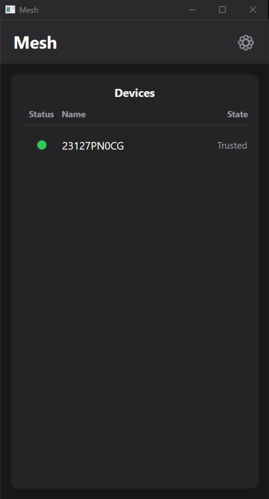

# Mesh

Mesh links a Windows PC and an Android phone on the same local network so they can chat. The desktop app runs on .NET 8 and WPF, the phone app is written in Kotlin.

[](https://github.com/murpiano/mesh/actions/workflows/ci.yml)

[How it works](#how-it-works) · [Run locally](#run-locally)

## What you can do

Open Mesh on both devices and they find each other on the network. Right-click a device on the PC, or hold it on the phone, and pick Connect. The first time, the receiving device shows a 6-digit code and asks to allow the connection, and the other device types that code in. After that, Connect only asks the other side to allow it. Click a device to open its chat: send text, copy any message, edit or delete your own. Edits and deletes show up on both devices. Each device keeps the last 50 messages per peer, and a message from the PC can be up to 1,048,576 characters long.

## How it works

### Discovery

Both apps advertise and browse the mDNS service `_meshlink._tcp` with their device id, name and listening port. The desktop uses `Makaretu.Dns.Multicast`, the phone uses Android's `NsdManager`. The listener takes a free port from the system, so nothing has to be configured, but the network has to pass multicast. When mDNS fails on the PC, the Devices page shows a banner with a Refresh button.

### Pairing

Every device creates its own self-signed RSA 2048 certificate on first launch and talks to peers over TLS. The pairing code comes from both certificate fingerprints and two random 16-byte nonces that each side commits to before revealing, hashed with SHA-256 and cut to 6 digits (`PinDerivation.cs`, mirrored byte for byte in `PinDerivation.kt`). A man in the middle would have to present a certificate that gives both sides the same code, which the commit step rules out. A paired device is remembered by its certificate fingerprint, so a reinstalled app on the other side asks to re-pair instead of connecting silently.

### Connection

After pairing, the same TLS socket becomes a long-lived session (`MeshSession`). Each side sends a heartbeat every 20 seconds and treats 45 seconds of silence as a drop. Reconnects are driven by the app (the window on the PC, the activity on the phone) and run with backoff of 1, 2, 4, 8, 16 and then 30 seconds. To keep both devices from dialing each other at once, only the one with the lower device id dials right away; the other waits 120 seconds and then tries every 45. A manual Disconnect sends a goodbye message so the peer stops reconnecting too. On the phone, a foreground service keeps the process alive while a session is open, otherwise Android would cut its network once the app is in the background.

### Chat history

The PC stores messages in SQLite, the phone in Room, both capped at 50 per peer. Every time a session opens, each side sends its whole history for that peer and the other merges in what it is missing by message id. That is how a chat comes back after a device was unpaired and paired again: the side that kept its copy replays it.

## Run locally

```bash
git clone https://github.com/murpiano/mesh.git
cd mesh

# Desktop app (Windows, .NET 8 SDK)
dotnet test src/windows/Mesh.sln
dotnet run --project src/windows/Mesh.App

# Phone app (JDK 17, Android SDK)
cd android
./gradlew testDebugUnitTest assembleDebug
adb install -r app/build/outputs/apk/debug/app-debug.apk
```

The phone needs Android 8.0 (API 26) or newer, and both devices need to be on the same network. The desktop app keeps its identity, paired devices and chat in `%AppData%\Mesh`. Debug builds are signed with the committed `android/app/debug.keystore`, so an APK built on any machine installs over an existing one.

Tests live in `src/windows/Mesh.Tests` (xUnit) and `android/app/src/test`. They write only to temporary folders; the discovery tests advertise a short-lived test service over mDNS. `.github/workflows/ci.yml` runs the Windows tests and builds the desktop app on Windows, and runs the Android unit tests and builds the APK on Linux, for every push to `master` and every pull request.

## Where things live

```text
android/                Android app (Gradle)
└── app/src/main/java/com/mesh/
    ├── core/           discovery, pairing, session, storage
    └── ui/             screens, popup, dialogs
src/windows/
├── Mesh.Core/          discovery, pairing, session, storage
├── Mesh.App/           WPF window, popup, dialogs
└── Mesh.Tests/         xUnit tests for Mesh.Core
docs/                   screenshot for this README
```

The protocol code exists twice, once per platform, and the two copies are kept in step by hand: the wire format, the PIN formula and the message tags have to match exactly.

## Rough edges

- Only one device is connected at a time. Connecting to another one drops the current session.
- Edits and deletes are sent only while the peer is connected. Made offline, they stay local.
- Unpairing is local. The other device still lists the pair until it next tries to connect.
- The "+" menu in the chat (Image, File) and the explorer tab do nothing yet: there is no file transfer.
- The phone accepts messages four times longer than the PC does. A message over 1,048,576 characters sent from the phone never shows up on the PC.
- No iOS or macOS version.

---

<sub>[Bogdan Trotsenko](https://github.com/murpiano) · [murpiano](https://github.com/murpiano) · [Telegram](https://t.me/murpiano) · [MIT](LICENSE)</sub>
